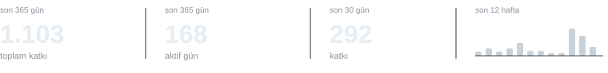

# sawet

**full stack developer**  

web'de bir şeyler tasarlıyor ve geliştiriyorum · google yzta 2026 kaggle datathon #1 <a href="https://github.com/sawetco/yzta-datathon-2026">↗</a>

<a href="https://sawet.co">sawet.co</a> · <a href="https://www.linkedin.com/in/sawet">linkedin</a> · <a href="mailto:ben@sawet.co">e-posta</a>

### teknolojiler / araçlar

  &nbsp;
  &nbsp;
  &nbsp;
  &nbsp;
  &nbsp;
  &nbsp;
  &nbsp;
  &nbsp;
  &nbsp;
  &nbsp;
  &nbsp;
  &nbsp;
  &nbsp;
  &nbsp;
  &nbsp;
  &nbsp;
  &nbsp;
  &nbsp;
  &nbsp;
  

projeler / <a href="https://esme.bel.tr">esme.bel.tr</a> · <a href="https://calculatr.app">calculatr.app</a> · <a href="https://rdronline.tr">rdronline.tr</a> · <a href="https://wordpress.org/plugins/paper-to-quiz/">paper to quiz</a>

### github / istatistikler

